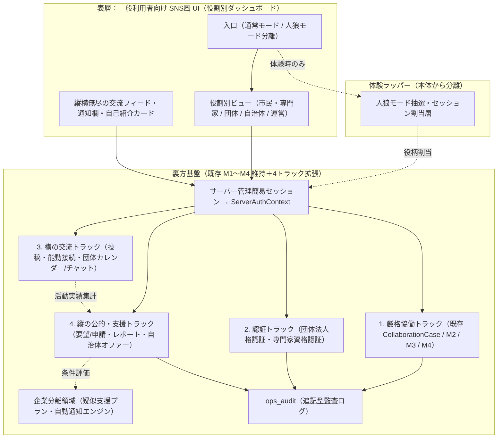

# Satoyama Nexus 模擬協働プラットフォーム アーキテクチャ・境界設計案 v0.1

- 日付：2026-11-25
- 状態：基本設計方針ドラフト（既存実装との差分比較・実装計画は後続工程）
- 参照：
  - `docs/product/m5-m6-simulated-venue-requirements.md`
  - `docs/architecture/m1-domain-design.md`
  - `docs/architecture/m1-auth-review-audit-contract.md`
  - `docs/architecture/m3-m4-ai-review-collaboration-contract.md`
  - `docs/decisions/0002-m1-domain.md`

---

## 1. アーキテクチャの基本方針（二層構成）

既存の M1〜M4 パッケージおよびスキーマを破壊せず、**「裏方の厳格基盤」を覆う形で「一般利用者向けのSNS風表層」を載せる二層構成**とする。

---

## 2. 4つの責務トラック分離設計

既存の `CollaborationCase`（1活動1案件・AI一次評価＋人間二次審査必須）に全機能を詰め込まず、責務ごとに4トラックへ分離しつつ、UI上ではシームレスに連携させる。

| トラック | 責務と主な対象 | AI/人間二次審査 | 監査（`ops_audit`） |
|---|---|---|---|
| **1. 厳格協働トラック**（既存維持） | 宛てがない人の運営仲介・公式協働（`CollaborationCase`） | **必須**（M2推薦→M3 AI一次評価→人間二次審査・自己審査禁止） | 全許可・拒否を原子記録 |
| **2. 認証トラック**（新規） | ・**市民団体認証**（法人格モデル＋団体責任者付与） ・**専門家資格認証**（`person` に対する根拠付き認証） | 運営による人間審査（理由付き追記履歴） | 申請・承認・却下を記録 |
| **3. 横の交流トラック**（新規） | ・SNS風投稿・コメント・賛同 ・能動マッチング接続（※未申請サポート外フラグ付き） ・認証済み団体専用のカレンダー・メンバー管理・メンバーチャット | 不要（スムーズな接続を優先） | 通常交流は非対象（団体構成変更など重要操作のみ選択記録） |
| **4. 縦の公的・支援トラック**（新規） | ・団体の活動実績ログ集計 → **簡易レポート生成** ・団体 → 自治体の要望・公的申請（レポート添付） ・自治体 → 各アカウントへのオファー・支援案内・提携申し出 | 自治体・運営による公的判断（履歴追記） | 全公的アクション・ステータス変更を原子記録 |

### トラック間のスムーズな接続点
- **横 → 認証**：一般市民・団体設立準備アカウントが運営へ団体認証を申請 → 認証完了で団体専用機能（カレンダー・チャット・レポート・公的申請）をアンロック。
- **横 → 縦**：認証済み団体がカレンダー実施記録・投稿・専門家助言を束ねて「簡易レポート」を生成し、自治体への要望・公的申請へ添付。
- **未接続 → 厳格協働**：市民が「宛てがない／紹介希望」を表明 → 運営の把握リストに表示 → 既存の M2→M3→M4 フローで安全に推薦・承認・通知。
- **縦・実績 → 企業通知**：団体の活動属性・実績が企業支援プランの条件に合致した際、分離された企業領域から支援申し出通知を発行。

---

## 3. 企業（疑似アカウント）の完全分離境界

将来の本番運用において、企業は他アカウント（個人・市民団体・自治体）と登録審査・権限・ダッシュボード規模が大きく異なるため、**`simulation.actor` には統合せず別テーブル群として物理分離**する。

- **既存保護**：`simulation.actor.kind` の制約（`'person' | 'organization' | 'government-body'`）および既存 M1 ドメインテストを変更しない。
- **分離構造（概念）**：
  - `simulation.corporate_sponsor`：疑似企業の基本情報（操作アカウントは紐付けない）
  - `simulation.corporate_support_plan`：支援プラン定義（対象タグ、エリア条件、必要実績条件、支援内容）
  - `simulation.corporate_support_offer`：条件合致により自動生成された支援申し出通知（対象団体・活動、合致根拠、通知日時）
- **デモ動作**：団体認証・活動登録・簡易レポート作成などのイベント（または評価エンドポイント）を契機に条件判定し、通知欄へ企業からの申し出を表示する。

---

## 4. 認証・セッション境界（M1契約の維持と人狼モード分離）

M1 の不変条件（**クライアント入力の `role` / `userAccountId` / `reviewerId` を信頼しない**）を保ったまま、5端末同時デモおよび人狼モードを軽快に運用するため、以下の境界を設ける。

### 4.1 サーバー管理の簡易セッション
- **配置**：`simulation` スキーマ内にデモ用アカウント表（`demo_account`）およびセッション表（`demo_session`）を置く（本番 OAuth プロバイダ導入前の Phase 1/デモ専用境界）。
- **仕組み**：
  - 新規登録または簡易ログイン時に、サーバーがランダムトークンを発行し **HttpOnly Cookie** として設定する。
  - すべての API リクエストでは、Cookie からサーバー側で `demo_session` を引き、現行の `ServerAuthContext`（`userAccountId`, `grants`, `operatedActorIds`）へ解決する。
  - クライアントから送信された権限・役柄パラメータは引き続き無視・拒否する。

### 4.2 市民団体の「法人格・責任者認証」データモデル
- 既存の `UserAccount` / `Actor` / `ActorMembership` 分離モデルをそのまま活かす：
  - 申請者：`demo_account` に紐づく `person` Actor。
  - 団体：`organization` Actor（認証状態：`pending_certification` / `certified` / `rejected`）。
  - 責任者認証：運営が団体認証を承認した際、`ActorMembership`（役割：`leader`）と、`demo_account` に対する団体操作権限（`operatedActorIds` への団体ID付与）をサーバー側で発行する。
  - 団体専用 API（カレンダー・メンバー管理・メンバーチャット・簡易レポート・公的申請）は、サーバー側で **対象団体が `certified` かつ操作アカウントが当該団体の認証済み責任者であること** を検証する。
  - デモでは団体メンバーは `simulation.actor`（`person`）および `ActorMembership`（役割：`member`）のダミーレコードとして登録し、ログインアカウントは紐付けない。

### 4.3 人狼モードの分離境界
- 人狼モードは独立した体験セッション（例：`demo_werewolf_room` / `demo_werewolf_assignment`）として本体ドメインから分離する。
- 運営役のみ据え置き、参加端末が入室・登録するとサーバー側で抽選を実行し、割り当てられた役柄に対応する権限・初期アクターを当該参加者の `demo_session` へ紐付ける。
- 本体ドメイン（4トラック・企業分離・監査）は「通常モードか人狼モードか」を一切意識せず、常に同一の `ServerAuthContext` 契約で動作する。

---

## 5. データ分離・プライバシー・透明性の境界

### 5.1 登録データと AI 入力の分離
- **内部属性（非公開）**：年齢・性別は `actor_profile` 等の内部カラムに保持し、一般向け API レスポンスおよび他者プロフィール表示からは除外する。
- **AI 入力除外（自己紹介カード）**：自己紹介テキストは `actor_profile.bio` として保存し、**M2 マッチング計算および M3 AI一次評価の入力ペイロードへ渡さない**（能動マッチング時のプロフィール表示のみに使用）。
- **固定グリッド → 実数値座標**：九州大学周辺の固定グリッドIDをサーバー側マッピング表で SRID 4326（緯度・経度）の `geography(Point, 4326)` へ変換して保存し、既存の PostGIS 空間処理・M2 地理評価へそのまま接続する。

### 5.2 公的承認過程の「保存」と「表示」の分離
- **保存層（固定方針）**：自治体・運営によるすべての承認・却下・認証・支援決定は、`ops_audit.audit_event` および各トラックの追記型履歴テーブルに完全記録する（UPDATE/DELETE 不可）。
- **表示層（切替可能設計）**：実運用での公開範囲が未確定のため、公的透明性ビューは表示ポリシー（例：`PUBLIC_APPROVAL_VISIBILITY = 'full-process' | 'outcome-only'`）で制御可能な構造とする。
  - デモ環境では `'full-process'` とし、申請内容・AI一次評価・審査理由・承認者・日時までの過程を可視化する。
  - 将来 `'outcome-only'` へ切り替えた場合も、内部監査ログを損なわずに「結果のみ一般表示」へ移行できる。

---

## 6. 同期方式と運用前提
- 5端末同時デモでの更新反映（通知到着、タイムライン更新、団体認証アンロック、自治体回答、人狼モードの抽選結果反映）は、クライアントからの **一定間隔ポーリング**（および操作直後の即時再取得）で実現する。
- Vercel 上のサーバーレス関数＋PostgreSQL/PostGIS 構成と整合し、常時接続（WebSocket/SSE）のインフラ制約を回避する。
